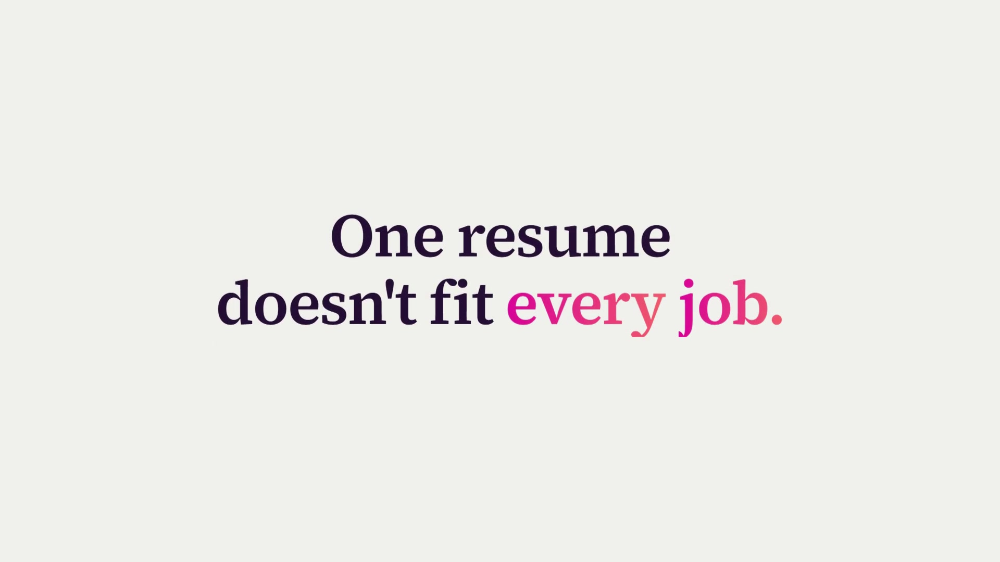
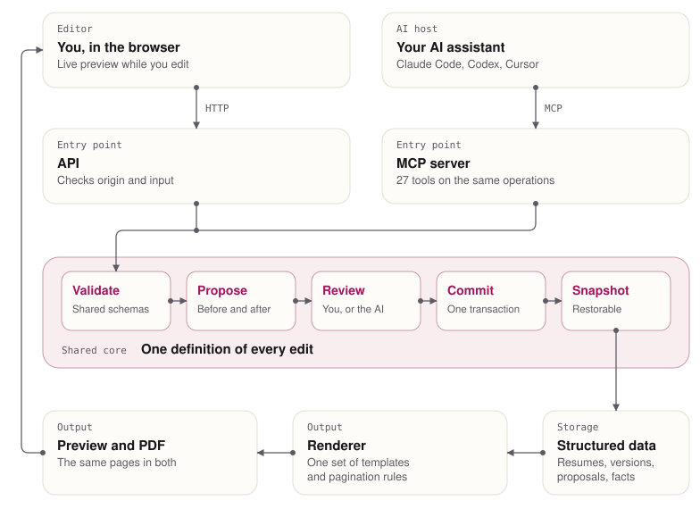

<h1 align="center">Resume Studio</h1>

<b>A structured resume editor where AI proposes changes and you review them.</b>

  
  
  

> [!NOTE]
> This is a showcase repository. Resume Studio is a commercial product, so the source code is private. I'm happy to walk through the code in an interview.

## Demo

**[Watch the demo](https://www.pranavguptachummun.com/work/resume-studio/#demo)**. An AI proposes four changes to a fictional CV. Two are accepted, one is rejected and the AI applies the last one. The CV then moves through five templates and exports as a PDF.

## Problem

Many people now use AI to update their resumes or tailor them to a job. Others don't use it at all. Either way, updating your resume for each job is tiresome. Even with AI, you read through what it says, then make every change yourself.

## What I built

An MCP app with a frontend. You plug in your own AI and it works seamlessly with the editor, giving you a resume updated for the job. You can review each change or let the AI apply it, and every change is recorded and can be restored.

Underneath is a structured resume editor with an API and MCP interface. Shared schemas and deterministic operations span all three entry points. Changes use transactional edits and immutable revisions, with scoped proposals and protection against stale edits.

## Architecture

<picture>
  <source media="(prefers-color-scheme: dark)" srcset="docs/architecture-dark.svg">
  
</picture>

- **One shared core.** The editor's API and the MCP server call the same operations, so every edit is validated by the same schemas whichever way it arrives.
- **Propose, then commit.** AI edits arrive as proposals with a before, an after and a reason. Accepting one commits it in a single transaction.
- **Immutable revisions.** Every commit creates a snapshot that can be restored, and stale edits are rejected instead of overwriting newer work.
- **One renderer.** The live preview and the PDF use the same templates and pagination rules, so the download matches what you saw.

## Key features

- **Bring your own AI.** Connect Claude Code, Codex or Cursor over MCP.
- **Tailored copies.** Clone your master resume for each job and keep the original intact.
- **Review or auto-apply.** See before, after and the reason for each change, then accept, reject or let the AI apply it.
- **Live preview.** Watch the page update as edits land.
- **Five templates.** Switch the design without touching your content.
- **Page fit check.** See how a change fits on the page before it goes in.
- **Version history.** Every edit is saved and can be restored.
- **PDF export.** The download matches the preview.

## Quality and testing

The project uses strict TypeScript, ESLint, CI and SQL migrations. Node tests and smoke scripts validate the implementation, and Playwright is part of the toolchain.

## What's next

Today, Resume Studio works with an AI you connect over MCP. Next, it becomes a full standalone app.

- **Built-in AI chat.** Ask for changes inside the editor, without connecting another app.
- **Backend LLM integration.** The app runs the AI itself, so there is nothing to connect first.

## Tech stack

TypeScript, Next.js, React, Zod, SQLite and PostgreSQL, Supabase Auth, Cloudflare Workers, Hyperdrive, Browser Run, MCP, Playwright

---

Built by [Pranav Gupta Chummun](https://www.pranavguptachummun.com). More of my work is on my [portfolio](https://www.pranavguptachummun.com) and [GitHub profile](https://github.com/pran-gc).
